<p align="center">
  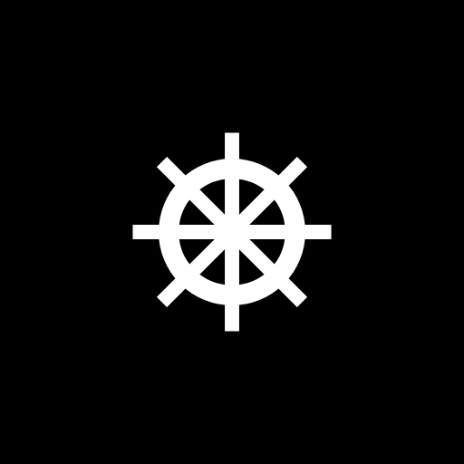
</p>

<h1 align="center">Leme<br><sub><sup><sup><sub>Copyright (©) 2026 Erik Pimenta</sub></sup></sup></sub></h1>

<p align="center">
  Linha de comando para operar um cluster distribuído de armazenamento chave-valor: um modo interativo com histórico, autocompletar e comandos de sessão, e um modo direto para scripts, com códigos de saída previsíveis e saída em tabela, JSON ou texto. Por trás, nós de verdade em Go: hash consistente com nós virtuais, réplicas com quórum ajustável, relógio híbrido, reparo na leitura, dicas para réplicas fora do ar, log com CRC e compactação, TLS e token. E um console web para ver tudo isso acontecer.<br>
  Pronto para usar, estudar ou adaptar.
</p>

<p align="center">
  Go 1.24 · Cobra · TCP com protocolo binário próprio · TLS 1.2+ e mTLS · HTML5 · CSS · JavaScript · Docker Compose · Prometheus · GitHub Actions
</p>

---

> **Manual completo:** [`Manual-Leme.pdf`](Manual-Leme.pdf) explica a instalação, os dois modos da CLI, cada comando com opções e exemplos, perfis de conexão, consistência, scripts e códigos de saída, o console web, a operação do cluster (subir, crescer, retirar nós, compactar, monitorar), a segurança e a solução de problemas, passo a passo (cópia em [`docs/`](docs/Manual-Leme.pdf)).

> **Banco de dados:** [`Banco-de-Dados-Leme.pdf`](Banco-de-Dados-Leme.pdf) traz a arquitetura do armazenamento: o formato binário do registro, os segmentos de log, o índice em memória, a recuperação após queda, a compactação, as lápides e o TTL, o versionamento com relógio híbrido, o anel de hash, a replicação, as regras para modelar chaves e como escalar (cópia em [`docs/`](docs/Banco-de-Dados-Leme.pdf)).

<p align="center">
  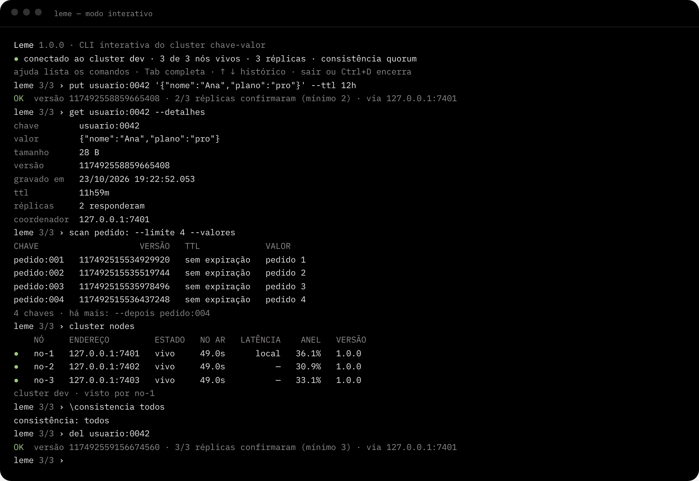
</p>

## O que o Leme faz

- **Modo interativo:** `leme` sem argumentos abre um terminal persistente conectado ao cluster. O prompt mostra quantos nós estão vivos, `Tab` completa comandos, subcomandos, opções e chaves já usadas, `↑` e `↓` navegam no histórico (que fica salvo entre sessões), `Ctrl+C` cancela o comando em andamento sem fechar a sessão e `Ctrl+A`, `Ctrl+E`, `Ctrl+W`, `Ctrl+U` e `Ctrl+L` editam a linha como num shell. Funciona no Windows Terminal, no PowerShell, no macOS e no Linux, sem dependências.
- **Comandos de sessão:** `\saida json`, `\consistencia todos`, `\tempo`, `\conectar host:porta` e `\historico` mudam a sessão sem reconectar. Operações perigosas pedem confirmação.
- **Modo direto para scripts:** `leme get usuario:42` executa e sai. A saída de `get` é o valor puro, pronto para `jq` e pipes, `put` aceita `-` para ler da entrada padrão e cada falha tem o seu código de saída (3 chave ausente, 4 cluster indisponível, 5 quórum não atingido, 6 conflito de versão, 7 token recusado). `leme shell --arquivo carga.leme` ou um pipe executam um comando por linha.
- **Dados:** `get`, `put` com TTL e escrita condicional (`--se-versao` e `--se-ausente`), `del` em lote, `exists`, `ttl`, `expire`, `scan` paginado por prefixo, `keys` e `count`. Todos aceitam `--consistencia um|quorum|todos` por operação.
- **Cluster:** `cluster status` (saúde, chaves, disco, operações e latência p99), `cluster nodes`, `cluster ring` (fatia do anel de cada nó), `locate` (quais nós guardam uma chave), `ping`, `node stats`, `node compact` e `node leave`, que transfere as chaves antes de retirar o nó.
- **Saídas:** tabela alinhada com cores só quando é um terminal (respeita `NO_COLOR`), JSON indentado para automação ou texto separado por tabulação.
- **Perfis:** `leme config set producao --nos ... --token-arquivo ... --tls-ca ...` guarda conexões com nós, token, TLS, consistência, tempo limite e formato padrão. Flags vencem variáveis de ambiente, que vencem o perfil.
- **Cluster local em um comando:** `leme dev` sobe N nós no mesmo processo, já ligados entre si, com os dados guardados entre execuções, e opcionalmente o console web.
- **Console web:** `leme console` abre visão geral, nós, anel com localização de chaves, navegador de chaves com gaveta para ler, editar e apagar, e um terminal com os mesmos comandos da CLI. Tema claro e escuro, layout para celular e nenhuma dependência externa: fontes, ícones e scripts vão embutidos no binário.
- **Carga sintética:** `leme bench` mede vazão e latência p50, p95, p99 e máxima com leituras e escritas misturadas.
- **Nós prontos para produção:** `lemed` com hash consistente, replicação configurável, quórum, relógio híbrido, reparo de leitura, dicas para réplicas fora do ar, gossip com detecção de falhas, redistribuição ao entrar e sair, log com CRC32C, recuperação de cauda corrompida, compactação sem parar o nó, TLS, mTLS, token, limite de conexões, `/saude` e métricas no formato do Prometheus.

<p align="center">
  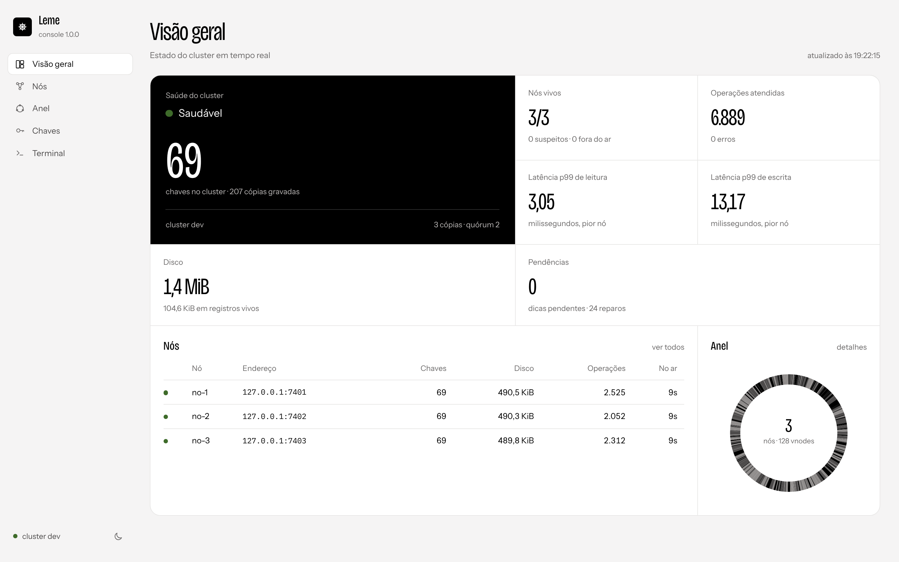
  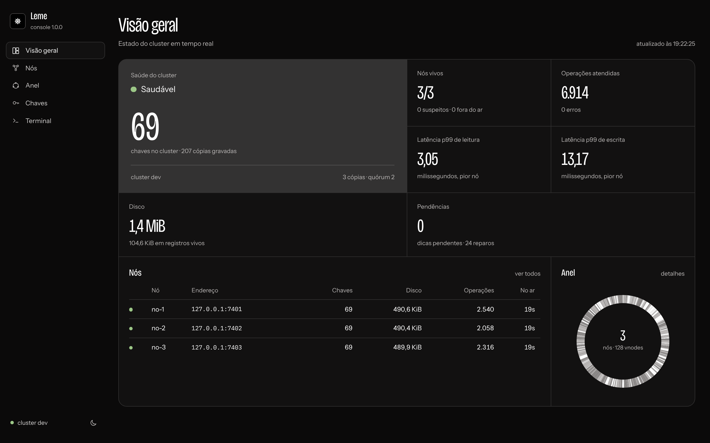
</p>

## Arquitetura

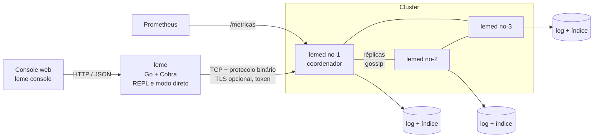

| Parte | Linguagem | Responsabilidade |
|---|---|---|
| `cmd/leme` | Go | Binário da CLI: modo interativo, modo direto, console web, cluster local e bench |
| `cmd/lemed` | Go | Binário do nó do cluster |
| `internal/cli` | Go (Cobra) | Árvore de comandos, flags globais, perfis, ajuda em português, códigos de saída |
| `internal/comandos` | Go | Registro único dos comandos de dados e de cluster, usado pela CLI, pelo REPL e pelo console |
| `internal/repl` · `internal/terminal` | Go | Laço interativo, editor de linha em modo cru (Linux, macOS, BSD e Windows), histórico e autocompletar |
| `internal/cliente` | Go | Cliente do cluster: topologia, roteamento pelo anel, conexões multiplexadas, novas tentativas com espera exponencial |
| `internal/no` | Go | Nó: servidor TCP, coordenação de leituras e escritas, quórum, reparo, dicas, gossip, redistribuição, métricas |
| `internal/armazenamento` | Go | Motor de armazenamento em log: registros com CRC32C, índice em memória, recuperação, compactação, TTL e lápides |
| `internal/anel` · `internal/protocolo` · `internal/transporte` | Go | Hash consistente, formato dos quadros e mensagens, conexões, pool e TLS |
| `internal/console/web` | HTML, CSS e JavaScript | Console web embutido no binário com `go:embed` |

### Como uma escrita acontece

1. A CLI calcula pelo anel quais nós guardam a chave e envia o `PUT` para o primeiro deles que estiver vivo. Qualquer nó pode coordenar.
2. O coordenador gera uma versão nova no relógio híbrido (milissegundos e contador) e envia o registro às `N` réplicas em paralelo.
3. Quando `W` réplicas confirmam (1, maioria ou todas, conforme a consistência), a CLI recebe a resposta. As demais continuam em segundo plano.
4. Se uma réplica está fora do ar, o coordenador guarda uma **dica** e entrega a escrita quando o gossip perceber que ela voltou.

Leituras consultam `R` réplicas, devolvem a versão mais nova e corrigem em segundo plano as que estavam atrasadas (**reparo de leitura**). Com `R + W > N`, que é o padrão com quórum, toda leitura enxerga a última escrita confirmada.

### Como o cluster se organiza

Cada nó entra pelo endereço de outro (`--entrar`) e passa a trocar a lista de membros por gossip a cada segundo. Um nó sem resposta vira `suspeito` em 3 segundos e `morto` em 10, e as operações deixam de esperá-lo. Quando alguém entra ou sai, o anel é recalculado e cada nó envia às novas réplicas as chaves que agora pertencem a elas. `leme node leave` faz o nó anunciar a saída, transferir tudo e só então sair do anel.

<p align="center">
  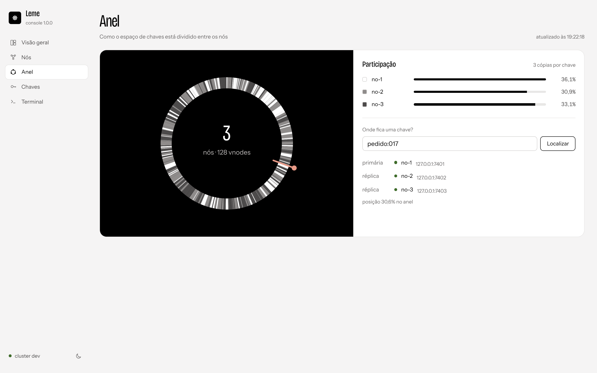
  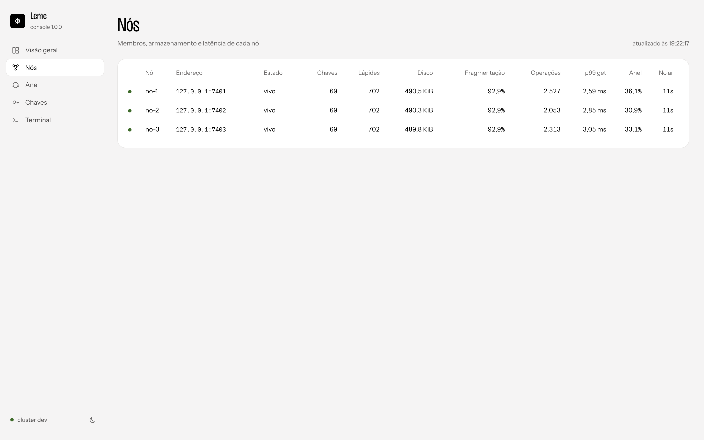
</p>

## Como rodar

### Com Docker (3 nós + console)

Você só precisa do **Docker** com Docker Compose.

**Windows:** dê dois cliques em `iniciar.cmd`.

**Linux ou macOS:**

```bash
./iniciar.sh
```

Na primeira vez o script cria o `.env` com um token aleatório para o cluster e outro para o console, sobe três nós `lemed` com volumes próprios e o console, e abre o navegador no endereço com o token. Sem Docker, os mesmos scripts compilam com o Go e rodam `leme dev`.

| Endereço | O que é |
|---|---|
| http://127.0.0.1:8080/?token=... | Console web (o endereço completo aparece no fim do script) |
| 127.0.0.1:7401 · 7402 · 7403 | Nós do cluster |
| `docker compose exec console leme --nos no1:7400` | Modo interativo dentro da rede do cluster |

### Sem Docker (Go 1.24+)

```bash
git clone https://github.com/ravelroot/Distributed-Key-Value-CLI.git
cd Distributed-Key-Value-CLI
go build -o bin/ ./cmd/...
./bin/leme dev --console 127.0.0.1:8080       # 3 nós locais + console
```

Em outro terminal:

```bash
./bin/leme --nos 127.0.0.1:7401               # modo interativo
./bin/leme --nos 127.0.0.1:7401 cluster status
```

No Windows os binários são `bin\leme.exe` e `bin\lemed.exe`. Para não repetir `--nos`, salve um perfil: `leme config set local --nos 127.0.0.1:7401,127.0.0.1:7402`.

### Um cluster de verdade

Em cada máquina, um `lemed` apontando para os nós que já existem:

```bash
lemed --id no-1 --endereco 0.0.0.0:7400 --anunciar 10.0.0.11:7400 --dados /var/lib/leme \
      --token-arquivo /etc/leme/token --tls-cert no.pem --tls-chave no.key --tls-ca ca.pem --metricas 0.0.0.0:9400
lemed --id no-2 --endereco 0.0.0.0:7400 --anunciar 10.0.0.12:7400 --dados /var/lib/leme --entrar 10.0.0.11:7400 ...
```

O manual traz o passo a passo completo, com geração dos certificados, serviço do systemd e Docker.

<p align="center">
  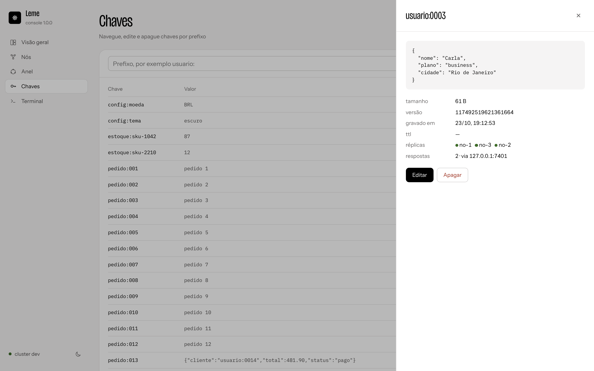
  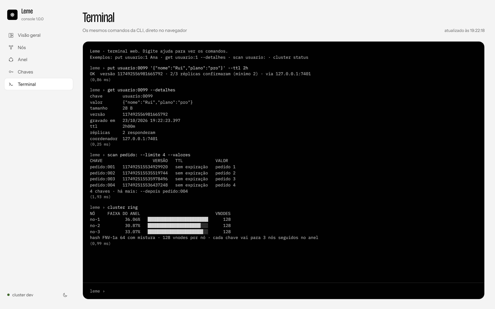
</p>

## Usando a CLI

```bash
# grava, com TTL, e lê
leme put sessao:9f3 '{"usuario":42}' --ttl 30m
leme get sessao:9f3

# metadados: versão, TTL, réplicas que responderam e coordenador
leme get sessao:9f3 --detalhes -c todos

# escrita condicional (controle de concorrência otimista)
V=$(leme get estoque:7 -o json | jq -r .versao)
leme put estoque:7 41 --se-versao "$V" || echo "alguém alterou antes"

# varre por prefixo, página por página
leme scan pedido: --limite 20 --valores
leme scan pedido: --limite 20 --depois pedido:0020

# arquivos e pipes
cat foto.png | leme put arquivo:foto -
leme keys usuario: -o texto | xargs leme del

# scripts com um comando por linha
leme shell --arquivo carga.leme --parar-no-erro
```

| Comando | O que faz |
|---|---|
| `get <chave>` | Lê o valor (`--detalhes` para metadados) |
| `put <chave> <valor \| ->` | Grava; `--ttl`, `--se-versao`, `--se-ausente`, `--arquivo` |
| `del <chave>...` | Apaga uma ou várias chaves |
| `exists <chave>` · `ttl <chave>` · `expire <chave> <duração>` | Existência, tempo restante e novo TTL |
| `scan [prefixo]` · `keys [prefixo]` · `count [prefixo]` | Lista paginada, só os nomes e contagem |
| `locate <chave>` | Réplica primária e demais réplicas da chave |
| `ping [nó]` | Latência até cada nó |
| `cluster status` · `cluster nodes` · `cluster ring` | Resumo, membros e divisão do anel |
| `node stats <nó>` · `node compact <nó \| todos>` · `node leave <nó>` | Estatísticas, compactação e saída de um nó |
| `shell` | Modo interativo ou execução de arquivo |
| `console` | Console web |
| `dev` | Cluster local para testes |
| `bench` | Carga sintética |
| `config list \| use \| set \| delete \| view` | Perfis de conexão |
| `completion bash \| zsh \| fish \| powershell` | Autocompletar do shell |

Todos os comandos aceitam `-o tabela|json|texto` e têm apelidos em português (`ler`, `gravar`, `apagar`, `varrer`, `localizar`, `cluster nos`, `node compactar`...). `leme <comando> --help` mostra opções e exemplos.

### Códigos de saída

| Código | Significado |
|---|---|
| `0` | Sucesso |
| `1` | Erro inesperado |
| `2` | Uso incorreto (argumentos, opções, valores) |
| `3` | Chave não encontrada (também `exists` quando a chave não existe) |
| `4` | Cluster indisponível ou tempo esgotado |
| `5` | Quórum não atingido |
| `6` | Conflito de versão em escrita condicional |
| `7` | Token recusado |

## Configuração

### CLI

| Variável | Flag | O que faz |
|---|---|---|
| `LEME_NOS` | `--nos` | Nós do cluster (`host:porta`, separados por vírgula). Padrão `127.0.0.1:7400` |
| `LEME_PERFIL` | `--perfil` | Perfil salvo com `leme config` |
| `LEME_TOKEN` | `--token`, `--token-arquivo` | Token do cluster |
| `LEME_CONSISTENCIA` | `-c` por comando | `um`, `quorum` (padrão) ou `todos` |
| `LEME_SAIDA` | `-o` | `tabela`, `json` ou `texto` |
| `LEME_CONFIG` | `--config` | Caminho do arquivo de perfis |
| `NO_COLOR` | `--sem-cor` | Desliga as cores |
| — | `--tls-ca`, `--tls-cert`, `--tls-chave`, `--tls-inseguro` | TLS e mTLS |
| — | `--tempo-limite` | Tempo máximo de cada operação (padrão 5s) |

### Nó (`lemed`)

| Variável | Padrão | O que faz |
|---|---|---|
| `LEME_ID` | `host-porta` | Identificador único do nó |
| `LEME_CLUSTER` | `leme` | Nome do cluster; nós de clusters diferentes se recusam |
| `LEME_ENDERECO` | `127.0.0.1:7400` | Onde o nó escuta |
| `LEME_ANUNCIAR` | o próprio endereço | Endereço que os outros usam para chegar até ele |
| `LEME_ENTRAR` | vazio | Nós já existentes para entrar no cluster |
| `LEME_DADOS` | `dados` | Pasta dos segmentos de log |
| `LEME_REPLICAS` | `3` | Cópias de cada chave |
| `LEME_VNODES` | `128` | Nós virtuais por nó no anel |
| `LEME_TOKEN` / `LEME_TOKEN_ARQUIVO` | vazio | Token exigido de clientes e pares |
| `LEME_TLS_CERT` / `LEME_TLS_CHAVE` / `LEME_TLS_CA` | vazio | TLS; com a CA, exige certificado do cliente (mTLS) |
| `LEME_SINCRONIZAR` | `intervalo` | `sempre` (fsync a cada escrita), `intervalo` (a cada 1s) ou `nunca` |
| `LEME_SEGMENTO_MB` | `64` | Tamanho máximo de cada segmento |
| `LEME_METRICAS` | vazio | Endereço HTTP de `/saude` e `/metricas` |
| `LEME_MAX_CONEXOES` | `4096` | Conexões simultâneas aceitas |
| `LEME_LOG` / `LEME_LOG_FORMATO` | `info` / `texto` | Nível e formato dos logs (`json` para coletores) |

<p align="center">
  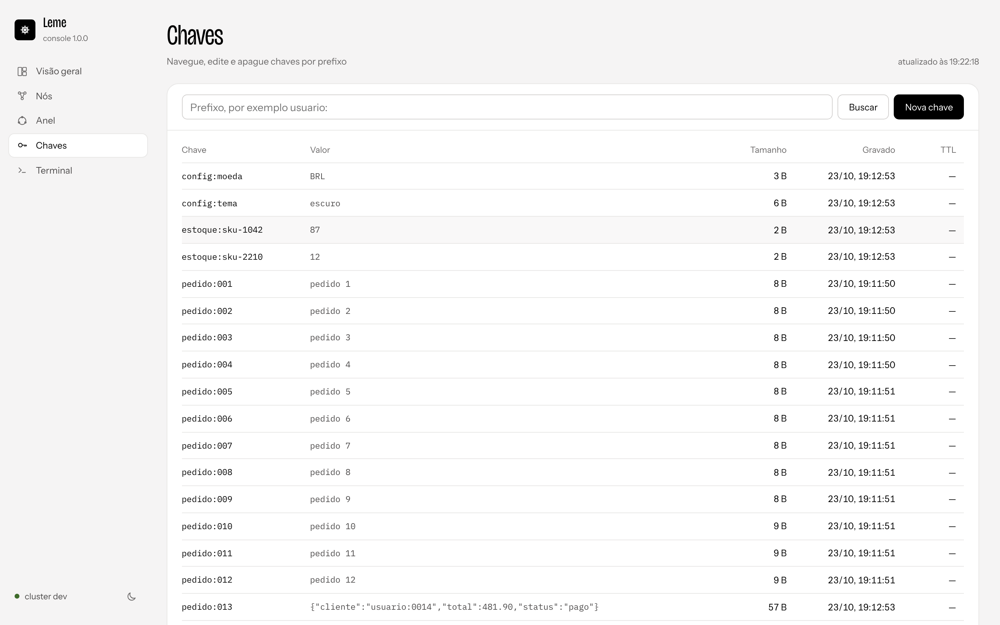
  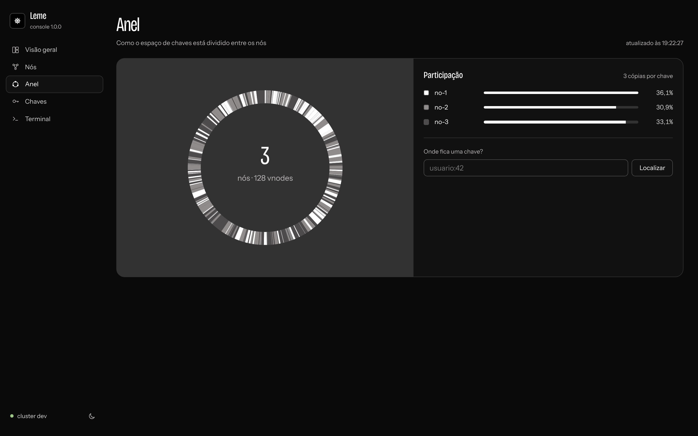
</p>

## Personalizando o Leme

| Quero... | Onde mexer |
|---|---|
| Novo comando de dados ou de cluster | Um `registrar(&Comando{...})` em `internal/comandos/dados.go` ou `cluster.go`. Ele aparece sozinho na CLI, no REPL, no autocompletar, na ajuda e no terminal web |
| Nova operação no protocolo | O código em `internal/protocolo/protocolo.go`, a mensagem em `mensagens.go`, o tratamento em `internal/no/coordenador.go` e o método em `internal/cliente` |
| Novo comando de sessão no REPL | `meta` em `internal/repl/repl.go` |
| Novo atalho de teclado | `editar` em `internal/terminal/editor.go` |
| Novo formato de saída | `internal/saida/saida.go` |
| Outra política de replicação ou quórum | `replicar` e `Ler` em `internal/no/coordenador.go` e `Necessarias` em `internal/protocolo/mensagens.go` |
| Outra função de hash ou de distribuição | `internal/anel/anel.go` |
| Outro formato de registro ou compactação | `internal/armazenamento` (veja o PDF do banco de dados antes) |
| Nova métrica | `internal/no/metricas.go` |
| Cores, fontes e layout do console | `internal/console/web/app.css` (variáveis no topo, tema escuro em `.dark`) |
| Nova página do console | `index.html`, `app.js` e uma rota em `internal/console/console.go` |

## Desenvolvimento e testes

```bash
go test -race ./...                 # testes de unidade e de integração com clusters reais em memória
bash scripts/ponta-a-ponta.sh bin   # 3 processos lemed + a CLI, como no CI
go vet ./... && gofmt -l .
make build                          # bin/leme e bin/lemed com versão e commit
```

Os testes sobem clusters de verdade, com nós em portas reais, e conferem quórum com um nó derrubado, escritas condicionais, TTL, token, reparo e entrega de dicas a um nó que volta, saída de nó sem perda de chaves, varredura que atravessa milhares de lápides, recuperação de log com cauda corrompida, detecção de bit trocado pelo CRC, compactação, distribuição e estabilidade do anel, robustez do decodificador contra mensagens truncadas, a CLI com seus códigos de saída, o modo não interativo, os perfis e o console web.

### Segurança e qualidade

| Área | Como ficou |
|---|---|
| Transporte | TLS 1.2+ opcional entre CLI e nós e entre os nós; com `--tls-ca` o nó exige certificado do cliente (mTLS) |
| Autenticação | Token comparado em tempo constante, com atraso fixo em cada tentativa errada; sem token, só `PING` responde |
| Entrada | Quadros limitados a 64 MiB, chaves a 64 KiB e valores a 32 MiB; o decodificador não confia em tamanhos declarados |
| Recursos | Limite de conexões por nó, de requisições simultâneas por conexão e de tempo por operação |
| Disco | Cada registro leva CRC32C; na abertura, uma cauda corrompida é truncada e o resto do log é preservado |
| Isolamento | Nós de clusters com nomes diferentes recusam o gossip um do outro |
| Console | Escuta só em `127.0.0.1`; fora disso exige token, entregue por cookie `HttpOnly` e `SameSite=Strict`. Pedidos que alteram dados precisam do cabeçalho `X-Leme`, e as respostas levam CSP, `nosniff`, `X-Frame-Options` e `Referrer-Policy` |
| Perfis | O arquivo de configuração é gravado com permissão `0600`; `leme config view` nunca mostra o token |
| Contêiner | Imagem Alpine com usuário sem privilégios, binários estáticos e healthcheck |

O GitHub Actions confere formatação e `go vet`, roda todos os testes com o detector de corridas, compila para Linux, Windows e macOS, sobe um cluster de três processos e exercita a CLI de ponta a ponta, e constrói a imagem Docker a cada push.

### Estrutura

```text
cmd/
  leme/                     CLI
  lemed/                    nó do cluster
internal/
  cli/                      comandos Cobra, flags globais, perfis, dev, bench, console
  comandos/                 registro dos comandos e o que cada um faz
  repl/                     modo interativo
  terminal/                 editor de linha e modo cru por sistema operacional
  saida/                    tabela, JSON e texto
  config/                   perfis de conexão
  cliente/                  cliente do cluster
  no/                       nó: coordenação, réplicas, gossip, dicas, métricas
  armazenamento/            log, índice, recuperação e compactação
  anel/                     hash consistente
  protocolo/                quadros e mensagens
  transporte/               conexões, pool e TLS
  console/                  servidor e páginas do console web
  teste/                    cluster de teste
scripts/                    teste de ponta a ponta e criação do .env no Windows
docs/                       manuais em PDF e imagens do README
.github/workflows/          CI
```

### Componentes de terceiros

O Leme depende de poucos componentes, cada um com a sua licença:

| Componente | Uso no projeto | Licença |
|---|---|---|
| [Cobra](https://github.com/spf13/cobra) e [pflag](https://github.com/spf13/pflag) | Estrutura de comandos e flags | Apache-2.0 / BSD-3-Clause |
| [mousetrap](https://github.com/inconshreveable/mousetrap) | Dependência do Cobra no Windows | Apache-2.0 |
| [Instrument Sans](https://fonts.google.com/specimen/Instrument+Sans), [Bricolage Grotesque](https://fonts.google.com/specimen/Bricolage+Grotesque) e [IBM Plex Mono](https://www.ibm.com/plex/) via [Fontsource](https://fontsource.org/) | Tipografia do console | OFL-1.1 |

O restante (protocolo, editor de linha, TLS, motor de armazenamento, console) usa só a biblioteca padrão do Go. As licenças das fontes acompanham os arquivos em `internal/console/web/fontes`. O nome Prometheus pertence aos seus donos e aparece só como formato de métricas compatível.

## Licença

Copyright (©) 2026 Erik Pimenta

Este projeto é distribuído sob a licença [MIT](LICENSE). Você pode usar, copiar, modificar e redistribuir o código, inclusive para fins comerciais, desde que mantenha o aviso de copyright e o texto da licença.
